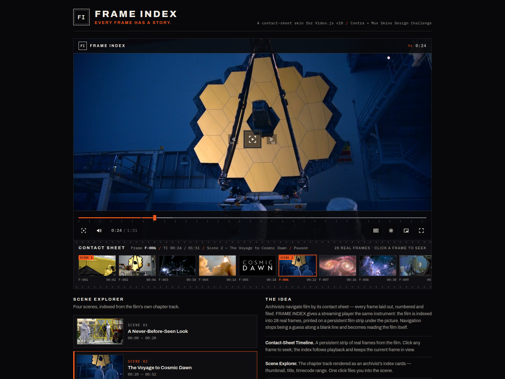

# FRAME INDEX — Every Frame Has a Story

A cinematic **contact-sheet skin for Video.js v10**, built for the Contra × Mux Video.js Skins Design Challenge.

Archivists navigate a film by its contact sheet — every frame laid out, numbered and filed. FRAME INDEX gives a streaming player the same instrument: the film is indexed into **28 real frames** on a persistent film strip under the picture, so navigation stops being a guess along a blank line and becomes reading the film itself.



## Signature interactions

- **Contact-Sheet Timeline** — a film strip of 28 real frames extracted from the demo film, each numbered (F-001 … F-028) with its timecode. Click any frame to seek; the strip follows playback, highlights the current frame in Signal Orange and keeps it in view. Scene-start frames carry a SCENE badge.
- **Scene Explorer** — the film's own chapter track rendered as an archivist's index cards: thumbnail, scene number, title, timecode range. One click files you into the scene; the active scene is marked as playback moves.
- **Precision feedback** — seek, skip and speed actions surface as bordered index indicators; a slate header carries a live timecode readout, and all clocks use tabular mono.

## The look

Matte editorial archive — **Deep Ink Black, Graphite, Warm Ivory, Muted Silver**, and a restrained **Signal Orange**. Flat 1px-ruled bands, a slate header, an "index rule" timeline whose chapter layer is printed with frame ticks, and a complete custom-drawn icon set. No glass, no gradients, no glow — print, not neon.

## Features (all functional, all tested)

- Play/pause with centre play, ±10s seek, timeline seek with chapter ticks
- Volume + mute, playback-speed menu, quality menu with the stream's real renditions (Auto / 270p / 480p / 720p)
- Captions menu — English and Japanese, plus Off
- Fullscreen, picture-in-picture (where the browser supports it)
- Full keyboard control with a visible Signal-Orange focus outline; controls stay available while keyboard-focused
- Auto-hiding controls when idle, loading/buffering states, ended state with restart, error dialog on stream failure
- Reduced-motion calming (`prefers-reduced-motion`)
- Responsive from 360px to 1440px+ with no overlap; menus stay inside the player

## Demo film

NASA's **"Cosmic Dawn"** trailer (public domain, 111s), streamed from Mux with chapter and EN/JA caption tracks. Contact-sheet frames, scene thumbnails and the poster were extracted locally from the film with ffmpeg (`apps/preview/public/frames/`, `chapters/`, `poster.jpg`, manifest in `frames/frames.json`).

## Tech

- **Video.js v10** — `@videojs/html` 10.4.0, `@videojs/mux-video` 10.4.0
- React 19, Vite, Tailwind CSS 4, TypeScript
- Skin source in `src/video/` (`skin.html`, `skin.ts`, `frameindex.css`); demo app in `apps/preview/src/demo/`

## Run it

```sh
npm install
npm run dev        # workbench with the demo
npm run typecheck  # tsc --noEmit
npm run build      # production build into dist/
```

`dist/index.html` is the full demo (player + contact sheet + Scene Explorer); `dist/preview.html` is the bare player.

## Quality evidence

An automated browser suite (Playwright + axe-core) drives the production build against the real stream: **28/28 checks pass**, including seek via timeline, contact-sheet frame and Scene Explorer; quality switching to a real rendition; captions reaching "showing"; fullscreen enter/exit; keyboard operation; **0 axe violations** on both pages; **0 console errors**. A full screen-reader pass has not been run and is not claimed.

## License

Apache License 2.0 — see [LICENSE](LICENSE). The demo film is a NASA production (public domain); its chapter/caption files and the extracted frames are included for demonstration.

---

Built by **Vikas Kumar Meena** · LIYANS DIGITAL · [github.com/liyansdigital](https://github.com/liyansdigital)
